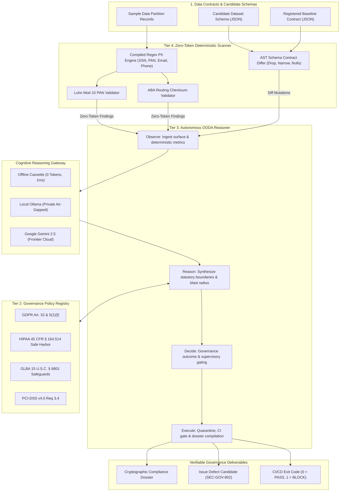

# 4-Tier Cognitive Architecture Specification

The **Enterprise Data Governance Agent** is structured around a strict **4-tier cognitive taxonomy**, balancing deterministic mathematical precision with adaptive LLM policy reasoning.

---

## Cognitive Tier Breakdown

### Tier 1: System Invariants (`AGENTS.md`)
- **Immutable Governance Boundary**:
  - Direct unmasked PII (SSN, unencrypted credit cards, bank credentials) is strictly prohibited outside dedicated Tier 3 Restricted security vaults.
  - Data contracts cannot be violated without formal deprecation lifecycles.
  - Governance decisions must be auditable with cryptographic trace IDs.
  - Probabilistic LLM tokens must never be used for deterministic mathematical operations.

### Tier 2: Governance Policies (`src/tier2-policies/regulatoryMapper.ts`)
- Maps detected vulnerabilities directly to legal standards:
  - **GDPR**: Article 32 (pseudonymization & encryption), Article 17 (erasure lineage).
  - **HIPAA**: 45 CFR § 164.514 (Safe Harbor 18 Protected Health Identifiers).
  - **GLBA**: 15 U.S.C. § 6801 (Nonpublic Personal Financial Information safeguards).
  - **PCI-DSS**: Requirement 3.4 (PAN protection).

### Tier 3: Autonomous OODA Agent (`src/agent.ts`)
- **Observe**: Collects schema metadata, sample records, and Tier 4 deterministic outputs.
- **Reason**: Evaluates statutory risk, checks classification drift, and computes downstream consumer blast radius.
- **Decide**: Evaluates the decision matrix (`APPROVE`, `APPROVE_WITH_WARNING`, `QUARANTINE`, `BLOCK_DEPLOYMENT`).
- **Execute**: Emits machine-readable dossiers, locks or unlocks the pipeline, and generates defect tickets.

### Tier 4: Zero-Token Deterministic Scanner (`src/tier4-deterministic/`)
- Compiled regular expressions for direct PII and contact information.
- Mathematical **Luhn Mod 10** verification for credit card PANs.
- Mathematical **Federal Reserve ABA Routing** transit number checksum calculation.
- AST schema contract differ for field deletions, type narrowing, and nullability violations.
- Executes in **< 2ms** with **0 LLM tokens burned**.
